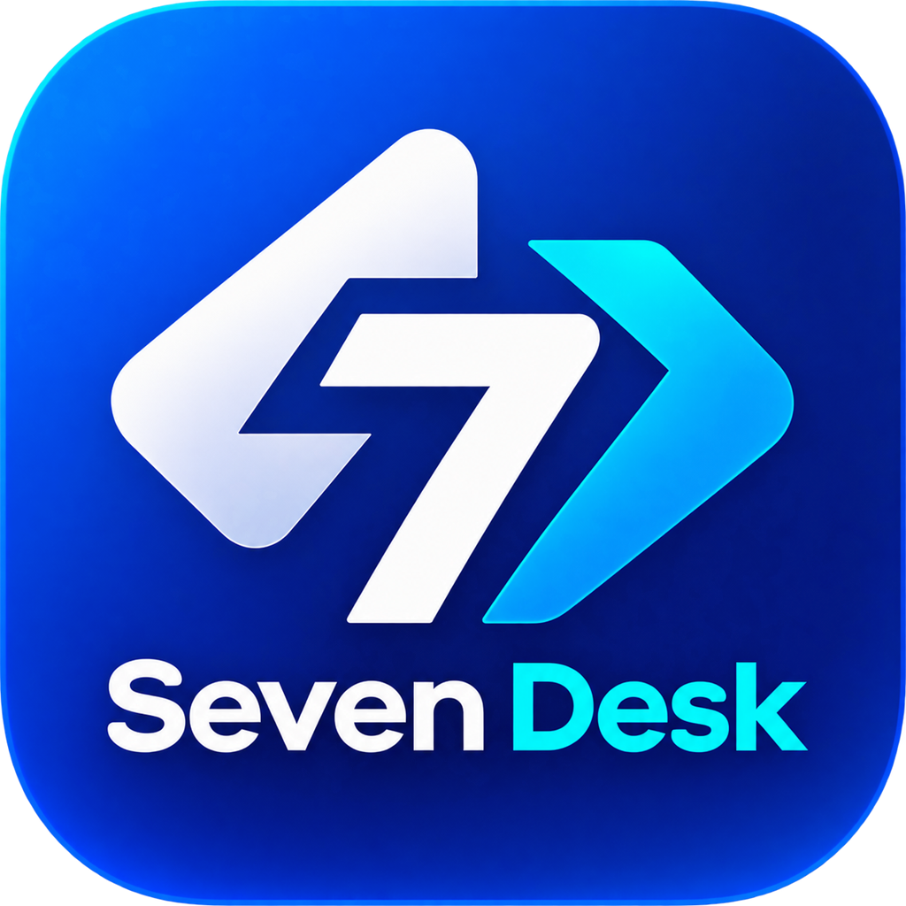

<p align="center">
  <a href="https://seven-desk-site.vercel.app/"><strong>Website oficial do Seven Desk</strong></a> · <a href="https://seven-desk-site.vercel.app/#plataformas">Downloads</a><br><br>
  <br>
  <a href="#passos-básicos-para-compilar">Compilar</a> •
  <a href="#como-compilar-com-o-docker">Docker</a> •
  <a href="#estrutura-de-arquivos">Estrutura</a> •
  <a href="#capturas-de-tela">Capturas de tela</a> •
  <a href="#contribuir">Contribuir</a><br>
  [<a href="docs/README-UA.md">Українська</a>] | [<a href="docs/README-CS.md">česky</a>] | [<a href="docs/README-ZH.md">中文</a>] | [<a href="docs/README-HU.md">Magyar</a>] | [<a href="docs/README-ES.md">Español</a>] | [<a href="docs/README-FA.md">فارسی</a>] | [<a href="docs/README-FR.md">Français</a>] | [<a href="docs/README-DE.md">Deutsch</a>] | [<a href="docs/README-PL.md">Polski</a>] | [<a href="docs/README-ID.md">Indonesian</a>] | [<a href="docs/README-FI.md">Suomi</a>] | [<a href="docs/README-ML.md">മലയാളം</a>] | [<a href="docs/README-JP.md">日本語</a>] | [<a href="docs/README-NL.md">Nederlands</a>] | [<a href="docs/README-IT.md">Italiano</a>] | [<a href="docs/README-RU.md">Русский</a>] | [<a href="docs/README-PTPT.md">Português (Portugal)</a>] | [<a href="docs/README-PTBR.md">Português (Brasil)</a>] | [<a href="docs/README-EO.md">Esperanto</a>] | [<a href="docs/README-KR.md">한국어</a>] | [<a href="docs/README-AR.md">العربي</a>] | [<a href="docs/README-VN.md">Tiếng Việt</a>] | [<a href="docs/README-DA.md">Dansk</a>] | [<a href="docs/README-GR.md">Ελληνικά</a>] | [<a href="docs/README-TR.md">Türkçe</a>] | [<a href="docs/README-NO.md">Norsk</a>] | [<a href="docs/README-RO.md">Română</a>]<br>
  <b>Ajude a aprimorar o SevenDesk: <a href="https://github.com/gabriell211/Seven-Desk">acesse o repositório</a>, contribua com o projeto ou compartilhe sugestões.</b>
</p>

> [!CAUTION]
> **Use com responsabilidade:** acesse somente dispositivos que você possui ou para os quais recebeu autorização. O acesso não autorizado, o controle sem consentimento ou a invasão de privacidade não são aceitáveis. Proteja suas credenciais e encerre as sessões quando não estiverem mais em uso.

Conecte-se a outros dispositivos e ofereça suporte remoto com o SevenDesk. O aplicativo é escrito em Rust, funciona em diferentes plataformas e permite que você mantenha o controle do seu ambiente e da configuração dos servidores de conexão e retransmissão.

## Downloads

Consulte a página de [versões do SevenDesk](https://github.com/gabriell211/Seven-Desk/releases) para verificar se há instaladores disponíveis. Os [workflows de CI e compilação](https://github.com/gabriell211/Seven-Desk/tree/main/.github/workflows) mostram os processos usados para cada plataforma.

## Dependências

As versões para desktop usam Flutter ou Sciter (descontinuado) como interface gráfica. As instruções abaixo são voltadas à versão Sciter. Para conhecer o processo de compilação da versão Flutter, consulte os [workflows do SevenDesk](https://github.com/gabriell211/Seven-Desk/tree/main/.github/workflows).

Baixe manualmente a biblioteca dinâmica do Sciter para sua plataforma:

[Windows](https://raw.githubusercontent.com/c-smile/sciter-sdk/master/bin.win/x64/sciter.dll) |
[Linux](https://raw.githubusercontent.com/c-smile/sciter-sdk/master/bin.lnx/x64/libsciter-gtk.so) |
[macOS](https://raw.githubusercontent.com/c-smile/sciter-sdk/master/bin.osx/libsciter.dylib)

## Passos básicos para compilar

- Prepare os ambientes de desenvolvimento do Rust e de compilação do C++.

- Instale o [vcpkg](https://github.com/microsoft/vcpkg) e configure corretamente a variável de ambiente `VCPKG_ROOT`.

  - Windows: `vcpkg install libvpx:x64-windows-static libyuv:x64-windows-static opus:x64-windows-static aom:x64-windows-static`
  - Linux/macOS: `vcpkg install libvpx libyuv opus aom`

- Execute `cargo run`.

## Como compilar no Linux

### Ubuntu 18 (Debian 10)

```sh
sudo apt install -y zip g++ gcc git curl wget nasm yasm libgtk-3-dev clang libxcb-randr0-dev libxdo-dev \
        libxfixes-dev libxcb-shape0-dev libxcb-xfixes0-dev libasound2-dev libpulse-dev cmake make \
        libclang-dev ninja-build libgstreamer1.0-dev libgstreamer-plugins-base1.0-dev
```

### openSUSE Tumbleweed

```sh
sudo zypper install gcc-c++ git curl wget nasm yasm gcc gtk3-devel clang libxcb-devel libXfixes-devel cmake alsa-lib-devel gstreamer-devel gstreamer-plugins-base-devel xdotool-devel
```

### Fedora 28 (CentOS 8)

```sh
sudo yum -y install gcc-c++ git curl wget nasm yasm gcc gtk3-devel clang libxcb-devel libxdo-devel libXfixes-devel pulseaudio-libs-devel cmake alsa-lib-devel gstreamer1-devel gstreamer1-plugins-base-devel
```

### Arch (Manjaro)

```sh
sudo pacman -Syu --needed unzip git cmake gcc curl wget yasm nasm zip make pkg-config clang gtk3 xdotool libxcb libxfixes alsa-lib pipewire
```

### Instalar o vcpkg

```sh
git clone https://github.com/microsoft/vcpkg
cd vcpkg
git checkout 2023.04.15
cd ..
vcpkg/bootstrap-vcpkg.sh
export VCPKG_ROOT=$HOME/vcpkg
vcpkg/vcpkg install libvpx libyuv opus aom
```

### Corrigir o libvpx (Fedora)

```sh
cd vcpkg/buildtrees/libvpx/src
cd *
./configure
sed -i 's/CFLAGS+=-I/CFLAGS+=-fPIC -I/g' Makefile
sed -i 's/CXXFLAGS+=-I/CXXFLAGS+=-fPIC -I/g' Makefile
make
cp libvpx.a $HOME/vcpkg/installed/x64-linux/lib/
cd
```

### Compilar

```sh
curl --proto '=https' --tlsv1.2 -sSf https://sh.rustup.rs | sh
source $HOME/.cargo/env
git clone --recurse-submodules https://github.com/gabriell211/Seven-Desk.git
cd Seven-Desk
mkdir -p target/debug
wget https://raw.githubusercontent.com/c-smile/sciter-sdk/master/bin.lnx/x64/libsciter-gtk.so
mv libsciter-gtk.so target/debug
VCPKG_ROOT=$HOME/vcpkg cargo run
```

## Como compilar com o Docker

Clone o repositório e crie a imagem Docker:

```sh
git clone https://github.com/gabriell211/Seven-Desk.git
cd Seven-Desk
git submodule update --init --recursive
docker build -t "sevendesk-builder" .
```

Depois, sempre que quiser compilar o aplicativo, execute:

```sh
docker run --rm -it -v $PWD:/home/user/rustdesk -v rustdesk-git-cache:/home/user/.cargo/git -v rustdesk-registry-cache:/home/user/.cargo/registry -e PUID="$(id -u)" -e PGID="$(id -g)" sevendesk-builder
```

A primeira compilação pode demorar mais enquanto as dependências são armazenadas em cache. As seguintes tendem a ser mais rápidas. Se precisar passar outros argumentos ao comando de compilação, adicione-os na posição `<ARGUMENTOS-OPCIONAIS>`. Por exemplo, para gerar uma versão otimizada de lançamento, acrescente `--release` ao comando. O executável ficará disponível na pasta `target`:

```sh
target/debug/rustdesk
```

Ou, para executar a versão de lançamento:

```sh
target/release/rustdesk
```

Execute esses comandos a partir da raiz do repositório SevenDesk; caso contrário, o aplicativo pode não encontrar os recursos necessários. Outros subcomandos do Cargo, como `install` ou `run`, não são compatíveis com esse método, pois instalariam ou executariam o programa dentro do contêiner, em vez de no sistema hospedeiro.

## Estrutura de arquivos

- **[`libs/hbb_common`](libs/hbb_common/)**: codec de vídeo, configuração, comunicação TCP/UDP e funções utilitárias compartilhadas com o servidor.
- **[`libs/base`](libs/base/)**: protobuf, funções de sistema de arquivos para transferência de arquivos, teclado e código de plataforma usados pelo aplicativo.
- **[`libs/scrap`](libs/scrap/)**: captura de tela.
- **[`libs/enigo`](libs/enigo/)**: controle de teclado e mouse específico para cada plataforma.
- **[`libs/clipboard`](libs/clipboard/)**: implementação de copiar e colar arquivos no Windows, Linux e macOS.
- **[`src/ui`](src/ui/)**: interface antiga em Sciter (descontinuada).
- **[`src/server`](src/server/)**: serviços de áudio, área de transferência, entrada, vídeo e conexões de rede.
- **[`src/client.rs`](src/client.rs)**: inicia uma conexão entre dispositivos.
- **[`src/rendezvous_mediator.rs`](src/rendezvous_mediator.rs)**: comunica-se com o servidor de conexão, aguardando uma conexão remota direta (TCP hole punching) ou retransmitida.
- **[`src/platform`](src/platform/)**: código específico para cada plataforma.
- **[`flutter`](flutter/)**: código Flutter para desktop e dispositivos móveis.

## Capturas de tela

As capturas de tela específicas do SevenDesk serão adicionadas aqui.

## Contribuir

Contribuições são bem-vindas. Consulte as [orientações para contribuir](docs/CONTRIBUTING.md) ou abra uma [issue](https://github.com/gabriell211/Seven-Desk/issues) para relatar um problema ou sugerir melhorias.


