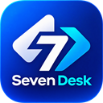

<div align="center">
  

  # Seven Desk

  **Acesso remoto para conectar, ajudar e trabalhar de qualquer lugar.**

  [Site oficial](https://www.sevendesk.tech/) · [Instaladores e versões](https://github.com/gabriell211/Seven-Desk/releases) · [Relatar problema](https://github.com/gabriell211/Seven-Desk/issues) · [Contribuir](#contribuindo)

  Aplicativo multiplataforma • Identidade visual própria • Interface em português do Brasil
</div>

---

## Sobre o Seven Desk

O **Seven Desk** é uma solução de acesso remoto para assistência técnica, acesso a computadores próprios e colaboração autorizada. O projeto reúne um aplicativo nativo, uma interface moderna, comunicação com servidores de identificação/retransmissão e um site próprio.

O objetivo é oferecer uma experiência simples para quem precisa acessar outro dispositivo, sem abrir mão de controles de conexão, permissões e transparência sobre o funcionamento.

> [!IMPORTANT]
> Utilize o Seven Desk apenas em computadores seus ou com autorização expressa do responsável. Nunca compartilhe senhas, chaves privadas ou códigos de acesso em issues públicas.

## Funcionalidades

| Área | O que o projeto oferece |
| --- | --- |
| Acesso remoto | Visualização e controle de uma sessão autorizada |
| Suporte técnico | Conexão a outros computadores para assistência |
| Arquivos | Ferramentas de transferência e gerenciamento de arquivos |
| Entrada e área de transferência | Integração de teclado, mouse e clipboard, conforme a plataforma |
| Conectividade | Conexão direta quando possível, com suporte a retransmissão conforme o ambiente |
| Multiplataforma | Código e fluxos de distribuição para Windows, macOS, Linux e Android |
| Identidade | Interface e logotipo Seven Desk com paleta escura e roxa |

A disponibilidade exata de cada recurso depende da versão instalada, do sistema operacional, das permissões e da configuração da rede.

## Download e instalação

Acesse **[www.sevendesk.tech](https://www.sevendesk.tech/#plataformas)** para selecionar seu sistema operacional ou consulte a página de **[Releases](https://github.com/gabriell211/Seven-Desk/releases)**.

1. Escolha uma versão publicada e verifique se existe um instalador para seu sistema e arquitetura.
2. Baixe e execute o instalador conforme as instruções da versão.
3. Abra o Seven Desk nos dispositivos envolvidos.
4. Inicie a conexão apenas após obter a autorização necessária.

**Observação:** os instaladores disponíveis e o estado das compilações variam de acordo com a release. Consulte os artefatos e resultados dos workflows antes de distribuir uma versão.

## Como funciona

A arquitetura tem três partes principais:

- **Aplicativo Seven Desk:** realiza a captura e exibição da sessão, o controle remoto e as operações permitidas pelo sistema.
- **Servidor de identificação e retransmissão:** auxilia na descoberta das partes e pode encaminhar tráfego quando a conexão direta não estiver disponível.
- **Site e área de conta:** apresentam o produto, os downloads e as páginas de autenticação e assinatura, cujo lançamento é controlado separadamente.

### Endereços oficiais

| Finalidade | Endereço |
| --- | --- |
| Site e páginas de conta | [www.sevendesk.tech](https://www.sevendesk.tech/) |
| Repositório e código | [gabriell211/Seven-Desk](https://github.com/gabriell211/Seven-Desk) |
| Instaladores | [Releases](https://github.com/gabriell211/Seven-Desk/releases) |
| Servidor configurado no cliente | `sevendesk.tech` |

O domínio do servidor remoto e o do website têm funções distintas. Não altere os endereços de sinalização/retransmissão somente para configurar o site: isso pode interromper conexões existentes.

### Contas, teste gratuito e assinaturas

A área de contas e os planos mensal/anual estão sendo preparados e homologados. As páginas públicas e os fluxos de autenticação podem ser publicados antes da abertura de novos cadastros.

**A cobrança não deve ser tratada como ativa apenas porque os preços são exibidos no site.** A liberação comercial depende da verificação de e-mail, confirmação de pagamento, tratamento de estornos e da validação da licença no serviço que autoriza as conexões remotas.

## Tecnologias

| Camada | Tecnologias presentes no projeto |
| --- | --- |
| Núcleo e comunicação | Rust |
| Aplicativos e interface | Flutter / Dart, com componentes nativos |
| Site | HTML, CSS e JavaScript |
| Build e testes do site | Node.js, esbuild e Node Test Runner |
| Infraestrutura do site | Vercel |
| Autenticação e dados de assinaturas | Neon Auth e PostgreSQL, nos fluxos em desenvolvimento |

O repositório inclui módulos e dependências de terceiros. A marca e os recursos visuais do Seven Desk não substituem os avisos de licença aplicáveis ao código incorporado.

## Estrutura do repositório

| Caminho | Responsabilidade |
| --- | --- |
| [`src/`](src/) | Cliente, serviços locais, comunicação e integração com o sistema |
| [`src/seven_server.rs`](src/seven_server.rs) | Configuração dos endpoints do Seven Desk no cliente |
| [`flutter/`](flutter/) | Interface e aplicativos multiplataforma |
| [`libs/`](libs/) | Bibliotecas de captura, rede e funcionalidades compartilhadas |
| [`website/`](website/) | Website, autenticação, APIs e testes do site |
| [`tests/`](tests/) | Testes do núcleo e de suas integrações |
| [`.github/workflows/`](.github/workflows/) | Validação e compilação automatizadas |
| [`docs/`](docs/) | Documentação técnica e orientações de contribuição |

**Importante:** `src/seven_server.rs` configura a conexão do **cliente** com o servidor. Esse arquivo não é, por si só, a implementação do servidor de sinalização e retransmissão implantado na infraestrutura.

## Desenvolvimento

### Pré-requisitos

Para desenvolvimento local, instale **Git**, o toolchain **Rust/Cargo** e as dependências nativas exigidas pela plataforma. Para trabalhar com a interface, instale também o **Flutter SDK** compatível com o projeto. O site utiliza **Node.js 24** e npm.

Clone o projeto com seus submódulos:

```bash
git clone --recurse-submodules https://github.com/gabriell211/Seven-Desk.git
cd Seven-Desk
```

### Site

```bash
cd website
npm ci
npm test
npm run build
```

O build do site gera os arquivos públicos em `website/public/`. As rotas de API e os módulos do servidor devem permanecer fora desse diretório. Não coloque credenciais de produção nos arquivos versionados.

### Aplicativo nativo

O núcleo é compilado com Cargo e a interface utiliza o Flutter. As dependências de captura, codecs e sistema variam entre Windows, Linux e macOS; por isso, **consulte os [workflows de compilação](.github/workflows/)** antes de executar builds para uma plataforma específica.

Para verificar o código Rust em um ambiente que já possua as dependências apropriadas:

```bash
cargo check
```

Esse comando não substitui a homologação do aplicativo, dos instaladores ou das conexões entre duas máquinas reais.

## Qualidade e segurança

Ao desenvolver ou revisar mudanças:

- Preserve o consentimento e as permissões de cada conexão remota.
- Nunca exiba senhas, chaves do servidor, tokens de sessão ou dados de pagamento nos logs públicos.
- Mantenha os fluxos de autenticação e cobrança bloqueados por padrão até os testes de ponta a ponta.
- Verifique as permissões do sistema e as diferenças entre plataformas.
- Execute testes e revise os resultados da CI antes de gerar uma release.
- Não altere os endpoints remotos ou a chave pública do cliente sem planejar a migração e testar a continuidade das conexões.

Problemas de segurança devem ser relatados **de forma privada**, sem publicar detalhes exploráveis em issues abertas.

## Contribuindo

Sugestões de recursos, correções e melhorias são bem-vindas. Consulte [as orientações de contribuição](docs/CONTRIBUTING.md) e abra uma [issue](https://github.com/gabriell211/Seven-Desk/issues) ou uma pull request com uma descrição objetiva, passos de reprodução e testes relevantes.

## Licença e atribuições

O repositório contém código coberto pela **GNU Affero General Public License, versão 3 (AGPL-3.0)**. Leia o texto em [`LICENCE`](LICENCE) para conhecer as condições e obrigações de uso, modificação, distribuição e disponibilização de código-fonte.

O Seven Desk utiliza componentes derivados do projeto **RustDesk**. Os créditos de autoria, avisos de copyright, termos da AGPL e licenças de outras dependências continuam aplicáveis aos componentes correspondentes. A identidade visual Seven Desk não altera esses direitos e obrigações.

---

<div align="center">
  

  **Seven Desk — Perto, mesmo de longe.**

  [Site](https://www.sevendesk.tech/) · [Downloads](https://github.com/gabriell211/Seven-Desk/releases) · [Termos e licenças](https://www.sevendesk.tech/licencas)
</div>
