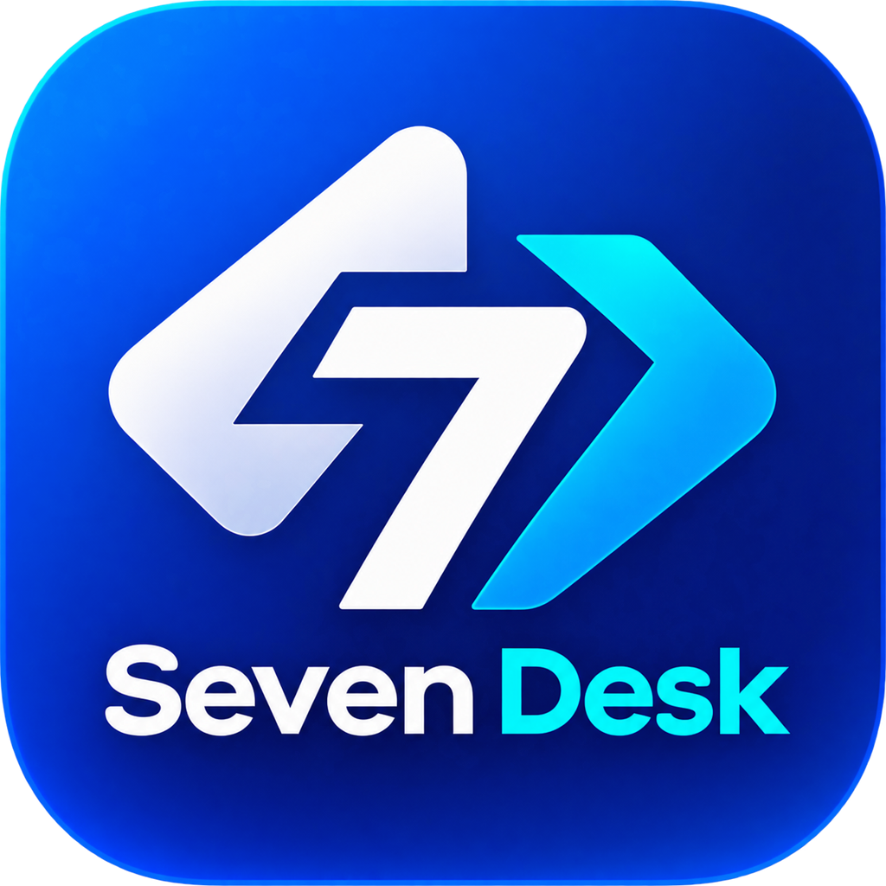

<p align="center">
  
</p>

<h1 align="center">SevenDesk</h1>

<p align="center">
  Acesso remoto simples, com a sua identidade visual e o seu jeito de trabalhar.
</p>

<p align="center">
  <a href="../README.md">English</a> ·
  <strong>Português (Brasil)</strong> ·
  <a href="README-PTPT.md">Português (Portugal)</a>
</p>

## Sobre o SevenDesk

O SevenDesk é um aplicativo de acesso remoto para conectar computadores e oferecer suporte à distância. Com ele, você pode visualizar e controlar outro dispositivo, transferir arquivos e usar recursos como área de transferência, áudio e túnel TCP durante uma sessão.

O projeto reúne o aplicativo para desktop e dispositivos móveis, com interface em Flutter e componentes de sistema escritos em Rust. O código-fonte e os fluxos de compilação estão disponíveis neste repositório.

## Recursos

- Acesso e controle remoto de dispositivos.
- Transferência de arquivos entre dispositivos conectados.
- Compartilhamento da área de transferência.
- Áudio e túnel TCP durante sessões remotas.
- Aplicativos e componentes para diferentes plataformas.

Os recursos disponíveis podem variar de acordo com a plataforma e a configuração da sessão.

## Downloads

Consulte a página de [versões do SevenDesk](https://github.com/gabriell211/Seven-Desk/releases) para verificar se há instaladores disponíveis. Você também pode acompanhar o [código-fonte](https://github.com/gabriell211/Seven-Desk) e os [fluxos de compilação](https://github.com/gabriell211/Seven-Desk/tree/main/.github/workflows).

## Segurança e uso responsável

Use o SevenDesk somente em dispositivos que você possui ou para os quais recebeu autorização. O acesso remoto pode permitir controlar o dispositivo e acessar seus dados; proteja suas credenciais e encerre sessões que não estiver usando.

## Compilar o projeto

Para obter o código-fonte com os submódulos necessários:

```sh
git clone --recurse-submodules https://github.com/gabriell211/Seven-Desk.git
cd Seven-Desk
```

A compilação depende das ferramentas e bibliotecas da plataforma de destino. Consulte os [workflows do GitHub Actions](https://github.com/gabriell211/Seven-Desk/tree/main/.github/workflows) para ver as versões das ferramentas e os passos usados para cada build.

## Estrutura do projeto

- [`flutter/`](../flutter/): interface do aplicativo em Flutter.
- [`src/`](../src/): aplicativo e serviços escritos em Rust.
- [`libs/`](../libs/): bibliotecas compartilhadas, captura de tela, entrada e área de transferência.
- [`.github/workflows/`](../.github/workflows/): automações de compilação e CI.

## Contribuir

Contribuições são bem-vindas. Consulte as [orientações para contribuir](CONTRIBUTING.md), abra uma [issue](https://github.com/gabriell211/Seven-Desk/issues) para relatar um problema ou envie uma proposta de alteração por pull request.
